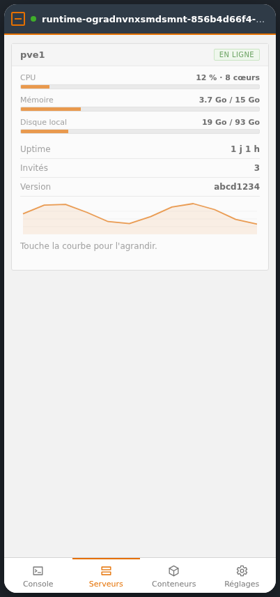
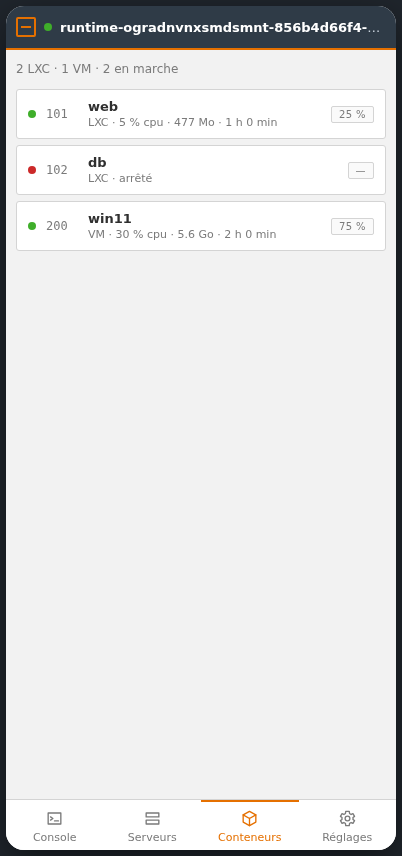
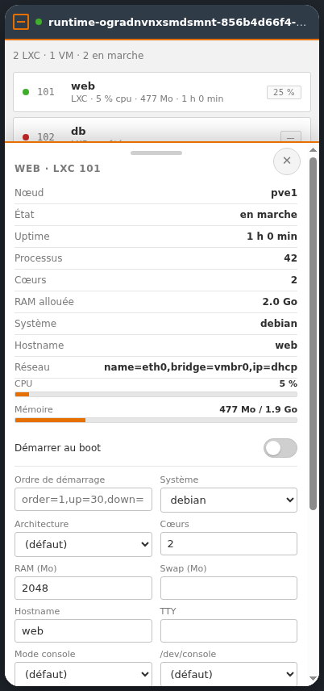

# ServerDeck

Console web **pensée pour le téléphone**, à installer dans un petit conteneur LXC sur
Proxmox : le terminal du serveur, le shell de chaque conteneur, l'état des ressources
et les boutons marche/arrêt — sans ouvrir un ordinateur.


## Fonctionnalités

**Terminal**
- terminal complet (xterm.js + PTY) avec **sessions tmux persistantes** : on ferme
  l'onglet, la commande continue ;
- barre de touches tactile (Esc, Tab, Ctrl/Alt *sticky*, flèches, Home/End, PgUp/PgDn,
  `|`, `~`, `/`, `-`) ;
- **presse-papier complet** : bouton « copier » (sélection), « coller », raccourcis
  `Ctrl+Shift+C/V` sur ordinateur, et **OSC 52** : le copier de tmux et des TUI arrive
  directement dans le presse-papier du téléphone ;
- **tactile** : défilement au doigt dans l'historique, appui long (550 ms) ou bouton
  « sélection » pour ouvrir le texte dans un bloc sélectionnable (fonctionne sur iOS,
  où le canvas du terminal ne permet pas la sélection native) ; champ de collage
  dédié pour le menu « Coller » d'iOS ;
- reconnexion automatique avec backoff, écran maintenu allumé, plein écran.

**Proxmox**
- **vue des ressources** : CPU, mémoire, disque local, uptime, version, invités ;
- **courbes cliquables** : un appui ouvre le graphique en grand, avec les plages
  heure / jour / semaine / mois et la valeur exacte sous le doigt ;
- **liste des conteneurs et VM** : état, vmid, type, CPU, mémoire, uptime ;
- **panneau d'un conteneur** : cœurs, RAM, système, hostname, réseau, jauges, courbe,
  **Terminal** en un appui, et **toutes les options Proxmox** modifiables :
  démarrer au boot, ordre de démarrage (`startup`), type d'OS, architecture,
  cœurs, RAM, swap, hostname, TTY, mode console (`cmode`), `/dev/console`,
  description ;
- **actions** : démarrer, arrêter proprement, couper, redémarrer ;
- **instantanés** : créer, revenir en arrière, supprimer ;
- **sauvegardes** : lancer un `vzdump` (mode snapshot/suspend/stop), lister les
  archives de l'invité et les supprimer ;
- **clone** complet et **agrandissement du disque** (`+2G`, `16G`) en un appui ;
- **recherche et filtres** de la liste : texte (nom, vmid, tag), LXC / VM /
  en marche / arrêtés, avec compteurs ;
- **tâches** : liste récente, journal complet, arrêt d'une tâche en cours, et une
  notification quand une sauvegarde, un clone ou un instantané se termine ;
- **nœud** : journal (`syslog`), **modèles LXC** (liste des appliances disponibles
  et téléchargement vers un stockage `vztmpl`), **redémarrage / arrêt** avec double
  confirmation ;

**Console**
- l'onglet Console ouvre par défaut le **shell du nœud Proxmox** ; le sélecteur en
  haut permet de basculer sur une session tmux locale ou un conteneur ;

**Réglages**
- **sessions actives** : qui est connecté, depuis quelle IP, révocation immédiate ;
- **langue** : français ou anglais (interface complète) ;
- taille du texte, plein écran, état du conteneur, déconnexion, hôte Proxmox.

**Fichiers**
- **gestionnaire de fichiers** : envoi de n'importe quel fichier depuis le téléphone
  (appareil photo, app Fichiers d'iOS, glisser-déposer sur ordinateur), liste avec
  taille et date, renommage, suppression, téléchargement ;
- **utilisation dans un conteneur** : un appui donne une **URL signée** et les
  commandes prêtes à coller (`wget`, `curl`) vers le dossier de ton choix, ou les
  colle directement dans le terminal du conteneur sélectionné ;
- stockage dans le conteneur ServerDeck, à côté de `config.json` : **512 Mo par
  fichier**, écrit en flux sur disque (jamais en mémoire, le conteneur n'a que
  256 Mo), refus net si le disque est plein.

**Le reste**
- interface au style de Proxmox VE (panneaux clairs, accents orange) ;
- PWA installable (plein écran, sans barre d'URL) ;
- **connexion avec les identifiants Proxmox** (`root@pam`, `admin@pve`…), **sans
  aucune configuration** : l'installateur transmet l'IP du nœud, et le ticket de
  l'utilisateur sert ensuite à interroger l'API. 2FA gérée, repli mot de passe local ;
- installateur animé (spinner, étapes, chrono) qui finit par l'URL, le QR code et
  les identifiants ;
- URL locale en `http://<nom>.local:8090` (mDNS).

## Captures

| Serveurs | Conteneurs | Panneau d'un conteneur |
| --- | --- | --- |
|  |  |  |

Les trois captures montrent : les jauges et la courbe CPU d'un nœud, la liste LXC/VM
avec leur état, et le panneau d'un conteneur — interrupteur « démarrer au boot »,
courbe, bouton Terminal, et toutes les options Proxmox modifiables.

## Installation (LXC Debian sur Proxmox)

Le conteneur est volontairement petit : **256 Mo de RAM et 4 Go de disque**
(1 Go ne suffit pas : Debian + compilateur + Node ≈ 1,3 Go ; 128 Mo de RAM
suffisent après installation).

Tout-en-un, depuis le nœud Proxmox (crée le conteneur **et** installe) :

```bash
CTID=109 bash -c "$(curl -fsSL https://raw.githubusercontent.com/heyhey2thereal/ServerDeck---Better-mobile-proxmox/main/packaging/create-lxc.sh)"
```

Le stockage des disques est détecté parmi ceux qui acceptent les racines de conteneur
(`rootdir`) ; pour forcer : `STORE=local CTID=109 bash -c "…"`.

> `raw.githubusercontent.com` garde `main` en cache quelques minutes : si le script
> semble ne pas prendre un correctif, remplace `main` par le SHA du commit
> (`.../raw/<sha>/packaging/create-lxc.sh`), l'URL est alors immuable.

Détail à la main — le dépôt doit être public pour l'installation sans jeton.

```bash
# sur le nœud Proxmox
pct create 210 local:vztmpl/debian-12-standard_12.7-1_amd64.tar.zst \
  --hostname serverdeck --cores 1 --memory 256 --swap 0 --rootfs local-lvm:4 \
  --net0 name=eth0,bridge=vmbr0,ip=dhcp --unprivileged 1 --features nesting=1
pct start 210
pct exec 210 -- bash -c "apt-get update && apt-get install -y curl ca-certificates"
pct exec 210 -- bash -c "$(curl -fsSL https://raw.githubusercontent.com/heyhey2thereal/ServerDeck---Better-mobile-proxmox/main/get.sh)"
```

Ou en clonant le dépôt :

```bash
pct exec 210 -- git clone <url-du-dépôt> /root/serverdeck
pct exec 210 -- bash /root/serverdeck/install.sh
```

L'installateur déroule les étapes avec un spinner (paquets, Node, dépendances,
configuration, service, mDNS), puis affiche un encadré final : **URL**, URL `.local`,
mot de passe local, secret TOTP et QR code à scanner.

Mise à jour : `git pull` puis relancer `./install.sh` (config et sessions conservées).

### Connexion Proxmox

**Rien à faire.** L'installateur connaît l'IP du nœud et l'enregistre : à l'écran de
connexion, tu tapes `root@pam` (ou ton utilisateur `@pve`) et son mot de passe. Le
ticket Proxmox obtenu sert ensuite à lire les ressources et à lancer les actions,
avec **tes droits** — aucun jeton d'API n'est nécessaire.

Deux options restent disponibles, facultatives :

- **jeton d'API** — utile pour un accès en lecture seule sans compte, ou si tu
  préfères ne pas garder de ticket en mémoire :
  `npm run setup:pve -- --host <ip> --token-id serverdeck@pve!api --token-secret '<secret>'`
  (créé par `packaging/proxmox-setup.sh` côté nœud) ;
- **terminal du nœud et des conteneurs** — automatique à l'installation. Pour un
  conteneur existant, une seule commande, sur le nœud en root :

  ```bash
  bash -c "$(curl -fsSL https://raw.githubusercontent.com/heyhey2thereal/ServerDeck---Better-mobile-proxmox/main/packaging/enable-ssh.sh)"
  ```

  Elle détecte le conteneur (nommé `serverdeck`), génère la clé, l'autorise avec la
  commande restreinte (`host` | `ct <vmid>`) et redémarre le service.

Le certificat TLS est accepté (`"verifyTls": false`, cas d'un certificat auto-signé
ou signé par l'autorité de cluster) ; pour une vérification stricte, mets
`"verifyTls": true` et `"ca": "/etc/pve/pve-root-ca.pem"`.

### Docker (test local)

```bash
mkdir -p data
docker compose run --rm serverdeck node src/setup.js --password 'motdepasse123' --no-totp --port 8090
docker compose up -d
```

## Configuration

`config.json` (créé par `npm run setup`, droits `0600`) :

| clé | rôle |
| --- | --- |
| `port`, `bind` | écoute (8090, `0.0.0.0` par défaut) |
| `allowLocalLogin` | `false` pour n'accepter **que** les identifiants Proxmox |
| `passwordHash` | scrypt du mot de passe |
| `totpSecret` | secret TOTP, `null` pour désactiver |
| `sessionSecret` | clé de signature des cookies |
| `sessionHours` | durée de session (168 h par défaut) |
| `trustProxy` | `true` derrière un reverse proxy (IP réelle, cookies `Secure`) |
| `shell`, `cwd` | shell et dossier de départ des sessions locales |
| `publicUrl` | URL externe utilisée dans les liens de fichiers (`https://deck.exemple`) |
| `proxmox.host`, `.port`, `.tokenId`, `.tokenSecret` | accès à l'API |
| `proxmox.verifyTls` | `false` pour un certificat auto-signé |
| `proxmox.ssh.user`, `.port`, `.keyPath` | accès SSH pour les shells |

`npm run setup -- --password '...' --totp --force` régénère l'authentification (les
sessions en cours sont invalidées). `npm run setup:pve` configure Proxmox.

## Sécurité — à lire avant d'exposer

Un terminal web, c'est une exécution de code à distance pour qui trouve l'URL.
L'application a déjà : mot de passe scrypt, TOTP, cookies signés `HttpOnly` +
`SameSite=Strict`, 6 tentatives par IP, en-têtes `X-Frame-Options`/`nosniff`, service
non-root, `MemoryMax` systemd.

Il reste à choisir **comment y accéder** :

1. **Tailscale (recommandé)** — rien d'exposé sur Internet :
   ```bash
   curl -fsSL https://tailscale.com/install.sh | sh && tailscale up
   ```
   Puis `http://<nom-tailscale>:8090` depuis le téléphone.
2. **Reverse proxy TLS** — Caddy dans le conteneur, écoute locale seulement
   (`"bind": "127.0.0.1"`, `"trustProxy": true`), puis :
   ```
   deck.example.com {
       reverse_proxy 127.0.0.1:8090
   }
   ```
3. **Jamais** de redirection de port brute vers 8090 depuis la box.

Côté Proxmox : le jeton API est en lecture seule si tu retires `VM.PowerMgmt`, et la
clé SSH est enfermée dans une commande forcée. Ne donne pas `host` si tu ne veux pas
de shell root sur le nœud.

## Terminal sur mobile

| Geste | Effet |
| --- | --- |
| Glisser verticalement | défilement de l'historique, ligne par ligne |
| Appui long (550 ms) | ouvre le texte du terminal dans un bloc sélectionnable |
| Bouton « sélection » | idem, sans attendre |
| Dans ce bloc : appui long | sélection native + menu Copier du système |
| « Tout copier » | copie tout l'écran en un geste |
| Champ « Coller dans le terminal » | appui long → Coller (le menu iOS s'ouvre sur un vrai champ), puis Envoyer |
| Bouton « coller » | lit le presse-papier et l'envoie directement |
| `Ctrl+Shift+C` / `Ctrl+Shift+V` | copier / coller sur ordinateur |

Le terminal est rendu dans un canvas (`touch-action: none`) : iOS et Android n'y
proposent pas le menu de sélection. D'où le bloc de texte dédié, qui se comporte comme
n'importe quelle page — et le champ de collage, sur lequel le menu « Coller » d'iOS
s'ouvre normalement.

## Shell du nœud et des conteneurs (SSH)

Les terminaux distants passent par une **clé SSH dédiée** dont la commande est
restreinte à deux actions :

```
clé serverdeck ──► /usr/local/sbin/serverdeck-shell ──► « host »       → bash -l sur le nœud
                                                    └─► « ct <vmid> »  → pct enter <vmid>
```

- clé générée dans le conteneur : `/var/lib/serverdeck/.ssh/serverdeck_ed25519` ;
- sur le nœud, `packaging/proxmox-setup.sh` crée l'utilisateur `serverdeck@pve`, le
  rôle (`VM.Audit, Sys.Audit, Datastore.Audit, VM.PowerMgmt`), un jeton d'API
  facultatif, le wrapper ci-dessus, et ajoute la clé à `/root/.ssh/authorized_keys`
  avec `command="…"` et `no-port-forwarding, no-agent-forwarding, no-x11-forwarding` ;
- si ce n'est pas en place, l'app reste en **session locale** (tmux) et l'onglet
  Console l'indique, avec une fiche contenant la commande.

Mise en place en une commande (détecte le conteneur nommé `serverdeck`) :

```bash
bash -c "$(curl -fsSL https://raw.githubusercontent.com/heyhey2thereal/ServerDeck---Better-mobile-proxmox/main/packaging/enable-ssh.sh)"
```

`bash /root/doctor.sh` teste ensuite la clé de bout en bout et affiche `SSH_OK`.

## Mise à jour et dépannage

```bash
bash /root/update.sh      # met à jour l'app (config, sessions, clé et fichiers conservés)
                          # et rafraîchit /root/update.sh pour les fois suivantes
bash /root/doctor.sh      # diagnostic complet (config, clé, autorisation, test SSH)
bash /root/reset.sh 109   # repart de zéro (efface la configuration)
```

## Utilisation

- **Connexion** : nom d'utilisateur Proxmox (`root@pam`, `utilisateur@pve`…) et mot
  de passe — c'est tout. Si le compte a la 2FA, l'app demande le code. Le lien en bas
  de page bascule sur le mot de passe local (secours si l'API est injoignable).
- **Onglets** : *Console* (shell du nœud PVE ou session locale), *Serveurs* (nœuds,
  courbes, tâches, journal, modèles, alimentation du nœud), *Conteneurs* (LXC/VM,
  recherche, panneau, instantanés, sauvegardes, clone, disque, terminal), *Fichiers*
  (envoi et partage vers les conteneurs), *Réglages*.
- **Fichiers** : « Envoyer un fichier » ouvre le sélecteur du téléphone. Un appui sur
  un fichier propose *Télécharger*, *Utiliser dans un conteneur* (lien signé 24 h +
  commandes `wget`/`curl`), *Renommer* et *Supprimer* (deux appuis).
- **Sessions tmux** : bouton en haut à droite. « + » crée, ✕ tue. La session `main`
  est créée au premier accès.
- **Copier/coller** : sélectionne du texte (appui long) puis « copier » ; « coller »
  envoie le presse-papier. Dans tmux, `set-clipboard` est déjà actif.
- **Ajouter à l'écran d'accueil** (Safari/Chrome) : l'app s'ouvre en plein écran.

## API

| route | description |
| --- | --- |
| `GET /api/health` | état public |
| `GET /api/auth-mode` | mode de connexion (Proxmox ou local) |
| `GET /api/me` | hôte, utilisateur, TOTP actif |
| `GET /api/system` | charge, mémoire, disque, uptime du conteneur |
| `GET /api/auth-sessions` | sessions web actives |
| `DELETE /api/auth-sessions/:id` | révoquer une session |
| `PUT /api/pve/guests/:node/:type/:vmid/config` | `onboot`, `description`, `startup` |
| `GET/POST /api/sessions`, `DELETE /api/sessions/:name` | sessions tmux |
| `GET /api/pve/overview` | nœuds + invités + compteurs |
| `GET /api/pve/check` | test de connexion à l'API |
| `GET /api/pve/nodes/:node` | statut + RRD d'un nœud |
| `GET /api/pve/storages/:node`, `GET /api/pve/tasks/:node` | stockage, tâches |
| `GET /api/pve/guests/:node/:type/:vmid` | statut + config + RRD d'un invité |
| `POST /api/pve/guests/:node/:type/:vmid/:action` | start, stop, shutdown, reboot, suspend, resume |
| `GET /api/pve/setup` | infos d'appairage (clé publique, ligne `authorized_keys`) |
| `GET/POST /api/pve/guests/:node/:type/:vmid/snapshots` | instantanés |
| `POST …/snapshots/:snap/rollback`, `DELETE …/snapshots/:snap` | retour arrière, suppression |
| `POST /api/pve/guests/:node/:type/:vmid/clone` | clone complet (`vmid`, `hostname`, `storage`) |
| `POST /api/pve/guests/:node/:type/:vmid/resize` | agrandir un disque (`disk`, `size`) |
| `POST /api/pve/guests/:node/:type/:vmid/backup` | lancer un `vzdump` |
| `GET /api/pve/backups/:node?vmid=`, `DELETE /api/pve/backups/:node/:storage/:volid` | archives |
| `GET /api/pve/tasks/:node/:upid`, `DELETE …` | journal d'une tâche, arrêt |
| `GET /api/pve/syslog/:node` | journal du nœud |
| `POST /api/pve/nodes/:node/power` | `reboot` ou `shutdown` du nœud |
| `GET /api/pve/templates/available/:node`, `POST /api/pve/templates/:node/download` | modèles LXC |
| `GET /api/files` | fichiers envoyés, espace utilisé et libre |
| `PUT /api/files/:name` | envoi brut (`application/octet-stream`), écrit en flux |
| `GET /api/files/:name` | téléchargement (session) |
| `DELETE /api/files/:name` | suppression |
| `POST /api/files/:name/rename` | renommage (`{"name":"…"}`) |
| `GET /api/files/:name/link` | URL signée pour un conteneur (`?hours=1..168`) |
| `GET /d/:name?t=…` | téléchargement par lien signé, sans session |
| `WS /ws?session=…` | terminal local (tmux) |
| `WS /ws?kind=ct&vmid=…` | shell d'un conteneur |
| `WS /ws?kind=host` | shell du nœud |

## Tests

```bash
npm test
```

- **33 tests unitaires** : auth (scrypt, jetons, limiteur), TOTP contre les vecteurs
  RFC 6238, client Proxmox contre un faux nœud (formes de réponse réelles, instantanés,
  clone, disque, sauvegardes, tâches, journal, modèles), stockage des fichiers (noms
  refusés, taille maximale, jetons signés) ;
- **15 vérifications du ticket Proxmox** (connexion, actions, refus) ;
- **49 vérifications de bout en bout** : serveur réel sur port aléatoire, config
  temporaire, faux nœud Proxmox et faux `ssh` — connexion par identifiants Proxmox
  (avec et sans jeton), **2FA**, repli local, cookie falsifié, terminal local, shell
  de conteneur, actions, option `onboot`, plages de courbes, instantanés, clone,
  redimensionnement, sauvegardes, tâches, journal, modèles, envoi/renommage/
  suppression/téléchargement de fichiers, lien signé sans session, refus des entrées
  invalides, blocage après 6 essais, déconnexion réellement invalidante.

## Empreinte

| | |
| --- | --- |
| Disque installé | ~1,3 Go (base Debian + outillage de compilation + ~75 Mo d'application) |
| Mémoire | ~60–75 Mo (Node + tmux) |
| Conteneur conseillé | 256 Mo / **4 Go** — 128 Mo de RAM après installation |

## Dépannage

- **« Connexion perdue » en boucle** : service arrêté (`systemctl status serverdeck`)
  ou proxy qui ne relaie pas les WebSocket.
- **Proxmox injoignable** : `"verifyTls": false` pour un certificat auto-signé ou
  signé par l'autorité de cluster ; pour une vérification stricte, mets
  `"verifyTls": true` **et** `"ca": "/etc/pve/pve-root-ca.pem"`. Vérifie aussi que
  le compte a `Sys.Audit` sur `/`.
- **« Impossible de joindre l'API Proxmox » au login** : c'est un problème TLS, de
  port 8006 ou de réseau, pas un mauvais mot de passe (le message est distinct).
- **Shell de conteneur refusé** : la clé doit être dans `/root/.ssh/authorized_keys`
  avec la commande forcée ; relance `packaging/proxmox-setup.sh`.
- **Actions refusées (403)** : le jeton n'a pas `VM.PowerMgmt`.
- **Sessions perdues** : elles vivent dans tmux, pas dans le service. Un
  `systemctl restart serverdeck` les garde ; un redémarrage du conteneur les tue.
- **Lien de fichier injoignable depuis un conteneur** : le conteneur doit pouvoir
  joindre l'IP de ServerDeck sur le port 8090 (même bridge). Sinon, télécharge le
  fichier depuis le téléphone puis copie-le depuis le nœud avec
  `pct push <vmid> fichier /root/fichier`.
- **« Fichier trop gros »** : 512 Mo par défaut. Pour changer, ajoute
  `Environment=SERVERDECK_MAX_FILE_BYTES=1073741824` à l'unité systemd.
- **« Espace disque insuffisant »** : le disque du conteneur (4 Go) est plein.
  Supprime des fichiers ou agrandis le disque (`pct resize 109 rootfs +2G`).
- **Instantané refusé** : le stockage du disque doit le supporter (LVM-thin, ZFS,
  `dir` sur ext4 avec `qcow2`). Un `local` classique refuse les instantanés.
- **Sauvegarde refusée** : le stockage cible doit avoir le contenu `backup`, et le
  compte les droits `Datastore.AllocateSpace` / `VM.Backup`.
- **Clone refusé** : le vmid choisi est déjà pris, ou le stockage cible est plein.
- **Journal ou tâches vides** : le compte a besoin de `Sys.Audit` sur `/` et
  `VM.Audit` (rôle `PVEAuditor` par exemple).
- **Après « Redémarrer le nœud »** : l'interface perd la connexion une minute, c'est
  normal ; recharge la page ensuite.
- **`npm install` avec npm 12** : les scripts d'installation sont bloqués par défaut,
  lance `npm install-scripts approve node-pty` puis `npm rebuild node-pty`.

## Structure

```
src/server.js       HTTP + WebSocket + authentification + routes Proxmox
src/proxmox.js      client API Proxmox (jeton, cache 3 s, RRD, actions)
src/ssh.js          shells de conteneurs et du nœud (SSH, commande restreinte)
src/files.js        stockage des fichiers envoyés + liens signés
src/pty.js          sessions tmux (socket dédié) et PTY
src/auth.js         scrypt, TOTP, jetons signés, limiteur
src/setup.js        génération de config.json
src/setup-pve.js    configuration Proxmox + clé SSH
public/             PWA (xterm.js, onglets, jauges, feuilles, presse-papier)
public/files.js     onglet Fichiers (envoi, actions, commandes pour les conteneurs)
packaging/proxmox-setup.sh   préparation du nœud Proxmox
install.sh          installation LXC animée + service systemd + mDNS + QR
get.sh              amorçage sans jeton (télécharge la release puis lance install.sh)
packaging/create-lxc.sh   création du conteneur LXC + installation, en une commande
tests/              unitaires + bout en bout (faux Proxmox, faux ssh)
```

## Licence

MIT — voir [LICENSE](LICENSE).
